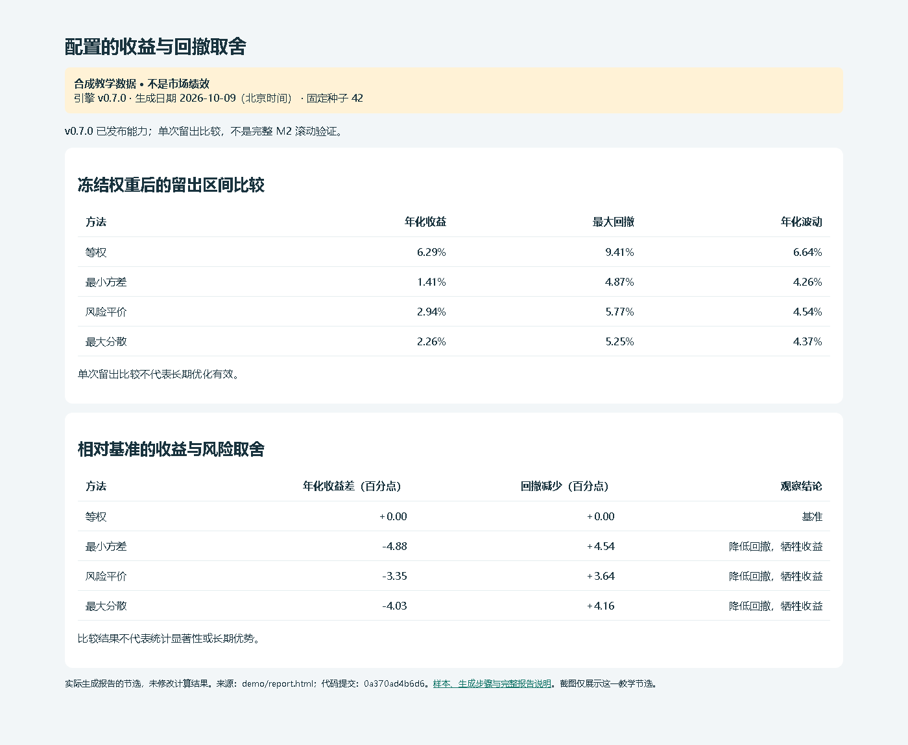

# 组合研究

比较配置、回撤、费用和现金需求，生成可核对的报告与账本。

[原创代码 MIT](LICENSE) · [发行说明](https://github.com/KILING-TASI/portfolio-decision-engine/releases/tag/v0.13.1) · [运行检查](https://github.com/KILING-TASI/portfolio-decision-engine/actions) · [English](README.en.md)

当前发布：**v0.13.1 · 普通发行版**。Python **3.10+**；基础功能只需 Python，无第三方运行依赖。

[快速开始](#快速开始) · [使用自己的资料](#使用自己的资料) · [能力与边界](#能力与边界) · [文档与维护](#文档与维护)

## 能解决什么问题

**我的钱集中在哪？几笔申购会不会撞上同一段资金占用？**

独立维护组合和现金情景；披露持仓可以从基金穿透工具导入，也可提供明确底稿。

| 需要准备 | 会得到什么 |
|---|---|
| 持仓金额或权重、日期、费用和现金需求；完整历史分析还需收益序列。 | 配置情景、已知敞口与未知比例、现金占用及费用记录。 |

## 快速开始

1. 安装 Python 3.10 或以上版本。
2. 下载[完整源码 ZIP](https://github.com/KILING-TASI/portfolio-decision-engine/releases/download/v0.13.1/portfolio-decision-engine-v0.13.1-source.zip)并解压，进入包含 `try_demo.py` 的目录。
3. 在该目录打开终端，运行：

```console
python try_demo.py --no-open --out-dir reports/first-demo
```

按终端给出的路径打开 HTML。也可以在源码目录双击 `Start-Demo.cmd`（Windows），或运行 `sh Start-Demo.sh`（Linux/macOS）。教学使用原创模拟资料，不自动取得真实数据。

使用 Git 时，先运行 `git clone https://github.com/KILING-TASI/portfolio-decision-engine.git`，再运行 `cd portfolio-decision-engine`，随后执行上面的教学命令。重复运行请指定新目录，历史结果会保留。

[报告示例源码](docs/previews/lookthrough.html)：GitHub 会展示 HTML 源码，请下载完整源码后在浏览器中打开。



截图对应历史教学样本，具体日期、参数和缺口以该报告为准。

## 使用自己的资料

先按[资料准备与排错](BEGINNER.md)整理来源、日期、单位和必要字段，再按[使用说明](USAGE.md)选择对应入口。以下两种使用方式分别配置。

**命令行（CLI）**：在源码目录安装本仓，然后查看可用命令：

```console
python -m pip install .
portfolio-decision-engine --help
```

可选组件按需要安装：`analysis`（历史分析）、`cnn`（CNN训练和预测）。例如 `python -m pip install ".[analysis]"`；依赖范围见 [使用说明](USAGE.md)。安装时下载构建工具或可选依赖可能需要联网。

**助手 Skill**：按 [SKILL.md](SKILL.md) 配置，保留完整目录及其引用资源。安装 CLI 不会自动注册 Skill，也不表示已在第三方技能市场上架。

| 身份 | 名称 |
|---|---|
| GitHub 仓库 / Python 发行包 | `portfolio-decision-engine` |
| 主要命令 | `portfolio-decision-engine` |
| SKILL.md 中的名称 | `portfolio-decision-engine` |

本仓可单独使用。需要跨工具功能时，再按说明安装并明确配置对应工具的位置。

因子进入组合前，可用 `portfolio-decision-engine factor exposure --input examples/factor-review/exposure.json --out-dir reports/factor-exposure` 试用。基础因子、暴露、成本及现金核对只需标准库；完整字段与多因子依赖见 [因子条件审查](FACTOR_REVIEW.md)。

CNN、K线规则和因子研究已独立到 [cn-factor-research](https://github.com/KILING-TASI/factor-research)。本仓负责组合敞口、成本、现金与约束；旧 `cnn/pattern` 入口保留。安装独立仓v0.1.x/v0.2.x时会委托其CLI，未安装时使用冻结v0.12兼容实现，不自动安装或读取兄弟仓。详见 [迁移兼容说明](FACTOR_MIGRATION.md)。

## 能力与边界

轻量金额入口无需科学计算包；完整风险、回归与优化按需安装 `.[analysis]`。不承诺更优配置或真实成交。

报告中的来源、日期、假设和未知事项需一起阅读。程序运行成功不等于来源已经认证、资料完整或投资判断有效。原创代码采用MIT，第三方代码、公告、研报和数据仍按各自权利范围处理。

## 文档与维护

- [详细命令与方法](USAGE.md)
- [资料准备与排错](BEGINNER.md)
- [Skill 调用指引](SKILL.md)
- [版本记录](CHANGELOG.md)
- [许可与第三方范围](THIRD_PARTY_NOTICES.md)
- [审计范围](AUDIT_SCOPE.md)
- [扩展专题](EXPANSION.md)
- [因子条件审查与教学](FACTOR_REVIEW.md)
- [CNN因子研究](CNN_RESEARCH.md)
- [K线形态及同样本对照](PATTERN_RESEARCH.md)

[贡献说明](CONTRIBUTING.md) · [安全反馈](SECURITY.md) · [更新与清理](LIFECYCLE.md)

[按问题选择其他工具](https://github.com/KILING-TASI/research-workbench/blob/main/references/tool-navigation.md)；资料契约校验已并入[数据仓](https://github.com/KILING-TASI/cn-data-adapters/blob/main/CONTRACT_MIGRATION.md)。默认分支的文档整理不改写已发布的源码包和历史结果；版本变化见 [CHANGELOG.md](CHANGELOG.md)。
